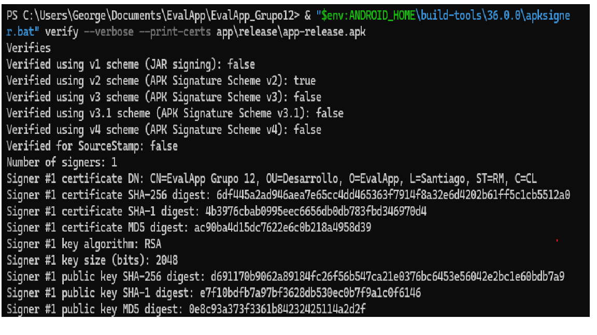
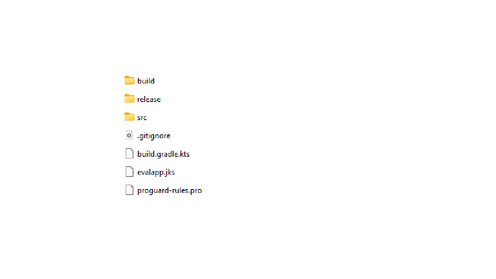

# EvalApp

Proyecto del grupo 12 para el ramo Desarrollo de Aplicaciones Móviles.

Integrantes:
- Ian Villalobos
- George Castillo

La app es para que docentes e instructores evalúen a sus alumnos con rúbricas desde el teléfono. Se elige el curso, el alumno (o varios si es un trabajo en grupo) y la rúbrica. En cada criterio se marca el nivel y la nota cambia al tiro. Cuando están todos los criterios evaluados se puede enviar.

Lo que hace la app:
- evaluar a un alumno o a un grupo con una rúbrica
- elegir el nivel de cada criterio (Muy buen desempeño, Logrado, Aceptable o No logrado) y ver la nota al tiro (1.0 a 7.0 con 60% de exigencia)
- comentario en cada criterio y un comentario general
- no deja enviar hasta evaluar todos los criterios
- historial con buscador, detalle, editar y eliminar evaluaciones
- crear, editar y eliminar rúbricas con sus criterios y niveles
- registrar, editar y eliminar alumnos por curso
- clima actual en el inicio (API externa)
- lo de la EP2: registro, inicio de sesión, editar datos, documentos PDF y Word, llamar a soporte y cerrar sesión

Está hecha en Kotlin con Jetpack Compose y MVVM. Los alumnos, las rúbricas y las evaluaciones se guardan en el microservicio (Kotlin con Spring Boot, en otro repositorio) y se leen con Retrofit. Los usuarios y documentos se guardan con SQLite. Todos los datos son de prueba.

Microservicio: https://github.com/mochaviruss/EvalApp_Microservicio_Grupo12

Endpoints del microservicio (desde el emulador es http://10.0.2.2:8080):
- /api/alumnos
- /api/rubricas
- /api/evaluaciones

Cada uno tiene GET para listar, GET /{id}, POST para crear, PUT /{id} para editar y DELETE /{id} para eliminar.

API externa del clima (Open-Meteo, no necesita clave):
- GET https://api.open-meteo.com/v1/forecast?latitude=-33.45&longitude=-70.66&current=temperature_2m,wind_speed_10m,weather_code

Para probarla:
1. Abrir el microservicio en Android Studio y en la terminal escribir `.\gradlew bootRun`.
2. Abrir esta app en otra ventana de Android Studio, esperar que cargue y darle a Run. Si pide elegir el Gradle JDK, usar jdk-21.
3. Entrar con uno de estos usuarios:
   - instructor: instructor@demo.cl / demo123
   - docente: docente@demo.cl / demo123

Para subir un PDF en el emulador hay que arrastrar el archivo a la ventana del emulador y después buscarlo en Descargas.

Pruebas unitarias: clic derecho en `app/src/test/java` > Run 'Tests in ...'. Prueban los ViewModel, los Repository y el cálculo de la nota.

APK firmado: está en `app/release/app-release.apk` y la llave en `app/evalapp.jks` (alias evalapp, clave evalapp123). La firma está configurada en `app/build.gradle.kts`.

Trello: https://trello.com/b/KUqkCuum

Más detalle de cómo está hecha en [docs/DOCUMENTACION.md](docs/DOCUMENTACION.md).
